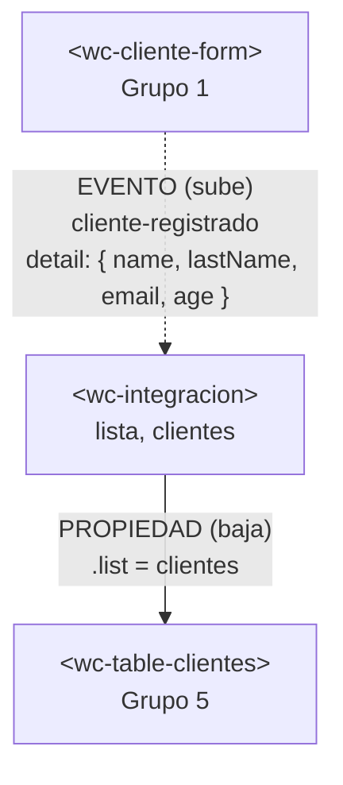

# Integración con el componente de otro equipo

## 1. Datos

| Campo | Valor |
|---|---|
| Equipo | Grupo 5 · Gestión de productos |
| Equipo externo | Grupo 1 · Gestión de clientes |
| Repositorio externo | https://github.com/A0Nicolas/APP-LIT-1 (rama `dev`) |
| Archivo externo | `src/components/clientes/cliente-form.js` → copiado en `src/externos/equipo-1/register.js` |
| Commit usado | `a81f226` (último commit de la rama `dev` al momento de copiar; verificar con `git log -1`) |

## 2. Componentes y roles

| Componente | Archivo | Origen | Rol |
|---|---|---|---|
| `<wc-integracion>` | `src/views/integracion/integracion.js` | Grupo 5 | **Padre**. Dueño de las listas `lista` (productos) y `clientes`. |
| `<wc-cliente-form>` | `src/externos/equipo-1/register.js` | Grupo 1 | **Hijo que emite**. Emite `cliente-registrado`. |
| `<wc-table-clientes>` | `src/views/integracion/cliente-tabla.js` | Grupo 5 | **Hijo que recibe**. Recibe `clientes` por la propiedad `.list`. |
| `<wc-form-producto>` | `src/views/home/register.js` | Grupo 5 | **Hijo que emite**. Emite `producto-registrado`. |
| `<wc-table-productos>` | `src/views/home/table.js` | Grupo 5 | **Hijo que recibe**. Recibe `lista` por la propiedad `.list`. |

## 3. Flujo de comunicación

El formulario del Grupo 1 emite `cliente-registrado` con `{ name, lastName, email, age }`. El padre escucha ese evento, convierte los datos al modelo de cliente de nuestro equipo, añade un identificador y crea un arreglo nuevo. La tabla recibe ese arreglo por la propiedad `list`, así que Lit vuelve a dibujarla.



**Adaptador.** El componente externo entrega `name`, `lastName`, `email` y `age`. Nuestra tabla usa `nombre`, `apellido`, `correo` y `edad`. El adaptador solo renombra los campos, convierte `age` con `Number()` y descarta el registro si falta algún dato o la edad no es un entero. Se escribe en el padre, nunca dentro del componente externo:

```js
registrarCliente(event) {
  const { name, lastName, email, age } = event.detail ?? {};
  const cliente = {
    id: this.clientes.length + 1,
    nombre: String(name ?? '').trim(),
    apellido: String(lastName ?? '').trim(),
    correo: String(email ?? '').trim(),
    edad: Number(age),
  };
  if (!cliente.nombre || !cliente.apellido || !cliente.correo || !Number.isInteger(cliente.edad)) {
    return;
  }
  this.clientes = [...this.clientes, cliente];
}
```

Los productos siguen el mismo patrón con el formulario propio (`producto-registrado` → `registrarProducto`).

## 4. Dificultades

| # | Integrante | Síntoma | Causa | Solución |
|---|---|---|---|---|
| 1 | Por confirmar | No se podía pasar el cliente a la tabla de productos: habría que poner la edad como precio, o nombre y apellido en la columna de producto. | El formulario del Grupo 1 entrega datos de clientes y nuestra tabla muestra productos (`nombre`, `categoria`, `precio`). Son dominios distintos. | Se añadió una tabla propia de clientes (`wc-table-clientes`) en el padre. Así ningún dato cambia de significado y ambas tablas reciben su propia lista por propiedad. |
| 2 | Por confirmar | El padre no tenía el componente: `src/externos/equipo-1/register.js` solo tenía un comentario "pendiente de recibir". | El repositorio tenía un marcador en lugar del archivo del Grupo 1. | Se reemplazó el marcador por una copia byte a byte del archivo del commit `a81f226`, verificada con `cmp`. |

## 5. Evaluación del componente externo

| Aspecto | Nota (0–5) | Evidencia |
|---|---|---|
| API clara | 3 | No recibe propiedades: solo emite `cliente-registrado` con `detail` de cuatro campos. Los nombres de los campos son claros, pero el evento y su `detail` no están documentados en el archivo (líneas 43–46). |
| Evento bien construido | 4 | Usa `bubbles: true` y `composed: true` (líneas 43–46), así que el padre lo escucha sin acceder al interior del componente. Envía un objeto en `detail` y `age` ya llega como número. |
| Robustez | 3 | Valida nombre, apellido, correo y edad (líneas 34–40) y no emite datos inválidos. Probado: la edad `30.5` muestra un mensaje del navegador, pero un nombre con solo espacios pasa el atributo `required`, la validación de JavaScript lo rechaza en la línea 40 sin ningún aviso y no se emite el evento. Ver issue #6. |
| Encapsulamiento | 5 | Sus estilos van en `static styles` (línea 11, dentro del shadow DOM). Probado en el navegador: el formulario se ve bien dentro de nuestra página y nuestros estilos no lo afectan. Consola sin errores (solo el aviso normal de modo desarrollo de Lit). |
| Reutilización | 5 | Solo importa `lit`, que ya es dependencia del proyecto. Se copió sin cambios y funciona sin archivos adicionales. |

Issue abierto: https://github.com/A0Nicolas/APP-LIT-1/issues/6

## 6. Uso de IA

| Herramienta | Quién la usó | Para qué | Qué cambiamos |
|---|---|---|---|
| Claude (Anthropic) | Alejandro De la Cruz | Revisar el código del Grupo 1, escribir el adaptador y la tabla de clientes, probar la integración en el navegador y redactar esta documentación. | Revisamos cada línea antes de subirla. El componente del Grupo 1 se dejó sin cambios; la adaptación quedó en el padre. La integración se verificó con `vite build` y con una prueba en el navegador. |

## 7. Aportes del equipo

| Integrante | Usuario de GitHub | Rol | Qué hizo | Enlace a sus commits |
|---|---|---|---|---|
| Cajas Dylan | byDayLand14 | Rol 2 · Adaptador y pruebas | Creó el formulario y la tabla de productos del equipo y revisó la integración | https://github.com/byDayLand14/app-it-grupo5/commits?author=byDayLand14⁠ |
| De la Cruz Alejandro | Aleshuga1020 | 3 · Revisión externa y 4 · Documentación | Integración del padre, adaptador, tabla de clientes, prueba en navegador, issue #6, documentación y revisión del pull request | https://github.com/byDayLand14/app-lit-grupo5/commits?author=Aleshuga1020 |
| Sangoquiza David | DavidSangoquiza | 1 · Integración | Apertura del pull request #2 | https://github.com/byDayLand14/app-lit-grupo5/commits?author=DavidSangoquiza |

Pull request: https://github.com/byDayLand14/app-lit-grupo5/pull/2 · Revisado por: Aleshuga1020 (aprobación y fusión pendientes).
